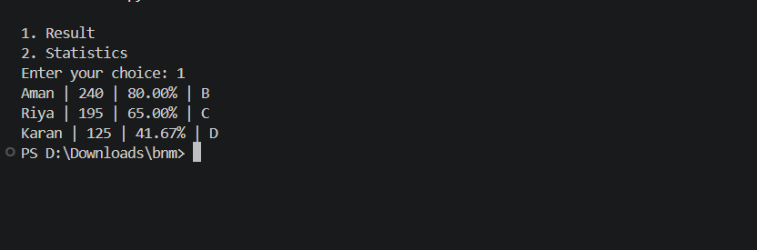
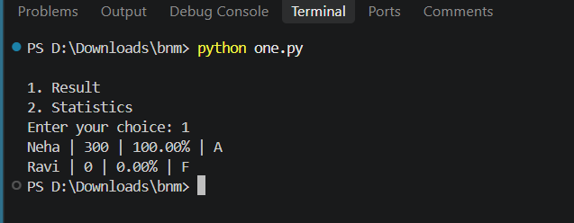
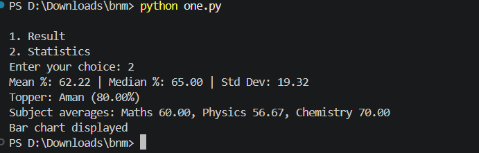
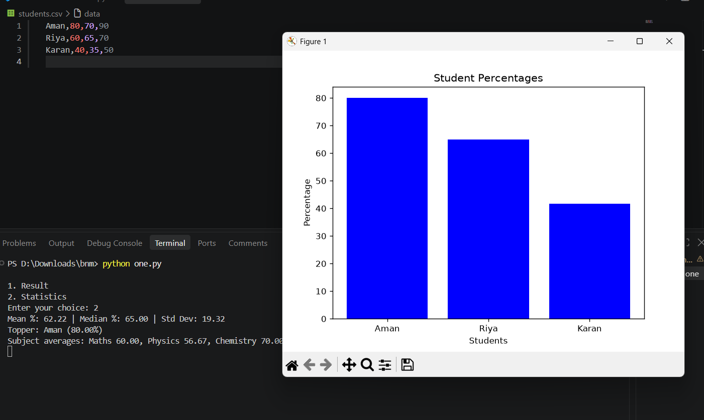

# Student Performance Analyzer (PS No. 85)

A Python-based console application that reads student marks from a CSV dataset, validates entries, calculates total marks, percentages, and grades, computes class statistics, and visualizes performance using charts.

---

## Concepts & Libraries Used
* **Language:** Python 3
* **Libraries:** `pandas`, `numpy`, `matplotlib`

---

## Grading Criteria
Marks are evaluated out of 100 in **Maths**, **Physics**, and **Chemistry**:
* **>= 90%**: Grade A
* **>= 75%**: Grade B
* **>= 60%**: Grade C
* **>= 40%**: Grade D
* **< 40%**: Grade F

---

## How to Run

1. Install the required libraries:
   ```bash
   pip install pandas numpy matplotlib
   ```
2. Ensure `students.csv` is in the same directory as `one.py`.
3. Run the program from the terminal:
   ```bash
   python one.py
   ```

---

## Test Cases & Output Screenshots

### Test Case 1: Normal Input
**Input (`students.csv`):**
```csv
Aman,80,70,90
Riya,60,65,70
Karan,40,35,50
```
**Menu Choice:** `1` (Result)

**Expected Output:**
```text
Aman | 240 | 80.00% | B
Riya | 195 | 65.00% | C
Karan | 125 | 41.67% | D
```
**Output Screenshot:**


---

### Test Case 2: Boundary / Minimum Input
**Input (`students.csv`):**
```csv
Neha,100,100,100
Ravi,0,0,0
```
**Menu Choice:** `1` (Result)

**Expected Output:**
```text
Neha | 300 | 100.00% | A
Ravi | 0 | 0.00% | F
```
**Output Screenshot:**


---

### Test Case 3: Invalid Input
**Input (`students.csv`):**
```csv
Amit,85,abc,70
```
**Expected Output:**
```text
Invalid marks for Amit in Physics: 'abc'. Row skipped.
```
**Output Screenshot:**


---

### Test Case 4: Class Statistics & Charts
**Input (`students.csv`):** *(Same as Test Case 1)*
```csv
Aman,80,70,90
Riya,60,65,70
Karan,40,35,50
```
**Menu Choice:** `2` (Statistics)

**Expected Output:**
```text
Mean %: 62.22 | Median %: 65.00 | Std Dev: 15.77
Topper: Aman (80.00%)
Subject averages: Maths 60.00, Physics 56.67, Chemistry 70.00
Bar chart displayed
```
**Terminal & Chart Screenshots:**


